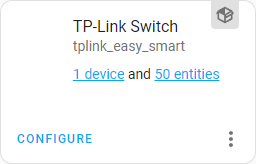
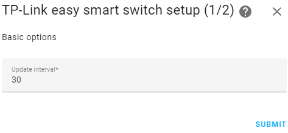
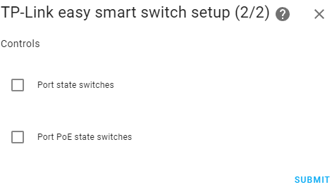

# TP-Link Easy Smart switches component for Home Assistant

Home Assistant custom component for control TP-Link Easy Smart switches over LAN.

**Requires Home Assistant 2026.10.4 or newer.** Version 0.4.0 is tested against HA 2026.10.4; it does not retain compatibility with older HA releases.

[](https://github.com/hacs/integration)
[](https://github.com/jcalvi/hass_tplink_easy_smart/blob/master/LICENSE.md)

[](https://github.com/jcalvi/hass_tplink_easy_smart/releases/latest)
[](https://github.com/JCalvi/hass_tplink_easy_smart/releases/latest)


## Key features

- obtaining information about all ports:
  - connection status
  - actual connection speed
  - configured connection speed
  - Poe status
  - Poe details (priority, power limits, actual power/current/voltage, power delivery class)
- ports management:
  - enable or disable specific ports
  - setting PoE parameters on the specified ports (enable/disable, priority, power limits)
- obtaining hardware and firmware version of the switch
- obtaining information about total PoE consumption
- setting limits on total PoE consumption
- automatic detection of available functions

## Supported models

|                                          Name                                            |  Revision | Confirmed |           Notes                             |
|------------------------------------------------------------------------------------------|-----------|-----------|---------------------------------------------|
| [TL-SG1016PE](https://www.tp-link.com/en/business-networking/poe-switch/tl-sg1016pe/)    |   V1, V3  |    Yes    | All features are available                  |
| [TL-SG105E](https://www.tp-link.com/en/business-networking/easy-smart-switch/tl-sg105e/) |     V5    |    Yes    | PoE is not supported by device              |
| [TL-SG108E](https://www.tp-link.com/en/business-networking/easy-smart-switch/tl-sg108e/) |     V6    |    Yes    | Network information & Port status supported |
| [TL-SG108PE](https://www.tp-link.com/en/business-networking/easy-smart-switch/tl-sg108pe/) | V5.0 | Yes | User-confirmed operation; Clear port statistics tested; firmware 1.0.0 Build 20230218 Rel.51358 |
| Other Easy Smart switches with web-based user interface                                  | --------- |    No     | Will most likely work                   

## Installation

### Manual

Copy `tplink_easy_smart` folder from [latest release](https://github.com/jcalvi/hass_tplink_easy_smart/releases/latest) to `custom_components` folder in your Home Assistant config folder and restart Home Assistant. The final path to folder should look like this: `<home-assistant-config-folder>/custom_components/tplink_easy_smart`.

### HACS

[Add a custom repository](https://hacs.xyz/docs/faq/custom_repositories/) `https://github.com/jcalvi/hass_tplink_easy_smart` with `Integration` category to [HACS](https://hacs.xyz/) and restart Home Assistant.

## Configuration

Configuration > [Integrations](https://my.home-assistant.io/redirect/integrations/) > Add Integration > [TP-Link Easy Smart](https://my.home-assistant.io/redirect/config_flow_start/?domain=tplink_easy_smart)


### Advanced options

You can perform advanced component configuration by clicking the `CONFIGURE` button after adding it. 



Advanced settings include:
|                                          Name                                           |  Default   |
|-----------------------------------------------------------------------------------------|------------|
| Update interval                                                                         | 30 seconds |
| Enabling or disabling [port state switches](docs/controls.md#port-state-switch)         |  Disabled  |
| Enabling or disabling [port PoE state switches](docs/controls.md#port-poe-state-switch) |  Disabled  |






## Sensors

* Network information ([read more](docs/sensors.md#network-information))
* PoE consumption ([read more](docs/sensors.md#poe-consumption))

## Binary sensors

* Port status ([read more](docs/sensors.md#port-status))
* Port PoE status ([read more](docs/sensors.md#port-poe-status))


## Switches

* Port state ([read more](docs/controls.md#port-state-switch))
* Port PoE state ([read more](docs/controls.md#port-poe-state-switch))


## Services

* Set the PoE power limit ([read more](docs/services.md#set-the-poe-power-limit))
* Set PoE settings for a specific port ([read more](docs/services.md#set-poe-settings-for-a-specific-port))


### Clear port statistics

When port statistics are supported, the integration creates a device-level **Clear port statistics** button. Pressing it clears the Tx/Rx good and bad packet counters for all ports and refreshes the displayed values immediately.

Clearing statistics has been tested on TL-SG105E, TL-SG108E and TL-SG108PE by [@JCalvi](https://github.com/JCalvi), and on TL-SG116E V2.20 by [@bakernigel](https://github.com/bakernigel). The TL-SG108PE test used hardware V5.0 and firmware 1.0.0 Build 20230218 Rel.51358. Hardware revisions and firmware versions for the TL-SG105E and TL-SG108E tests were not recorded.

## Credits

- [@bakernigel](https://github.com/bakernigel) contributed the Clear port statistics button and tested it on a TL-SG116E V2.20.

## Development and testing

Use Python 3.14.2 or newer:

```sh
python -m pip install -r requirements_test.txt
python -m pytest -q
```

The suite imports the real Home Assistant integration and tests HTTP transport against a local simulated switch. It covers configuration migration, options and reauthentication, permissions on the selected switch/port, service lifecycle, availability, malformed responses, recovery, and counter clearing. Physical switch/firmware testing remains necessary for protocol compatibility.

Releases run the tests before creating the tag and ZIP. Release notes are in [RELEASE_NOTES.md](RELEASE_NOTES.md).

### Action permissions

Internal automations retain normal Home Assistant behavior. Administrators can manage all switches. For a restricted user, a port PoE action requires control permission on that port's registered PoE switch (or PoE state entity if controls are disabled). A global PoE limit change requires control permission on all registered entities of the target switch. Permission to control another switch does not grant access to the target.
